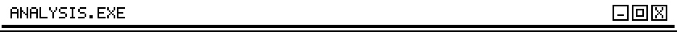

<!-- Images in assets/ are generated by scripts/build.py — edit the DATA section there and re-run. -->

  

  

  

  

  

  
  

  

  

  <picture>
    <source media="(prefers-color-scheme: dark)" srcset="https://raw.githubusercontent.com/glykamarieee/glykamarieee/output/snake-dark.svg" />
    <source media="(prefers-color-scheme: light)" srcset="https://raw.githubusercontent.com/glykamarieee/glykamarieee/output/snake-light.svg" />
    
  </picture>

  

  
  <!-- Add your links, then remove the comment markers:
  
  
  
  -->
  

  

